# 🏗️ Architecture Diagrams - All Active Repos

**Use Mermaid Live Editor to view:** https://mermaid.live

---

## 1️⃣ **EIC (eInvoice Connect) - Customer Payment Portal**

### **High-Level Architecture**

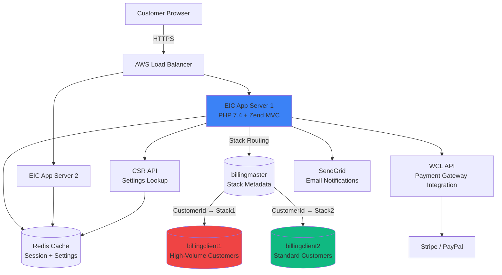

**One-Liner:**
> "EIC = Customer-facing portal where users view invoices, make payments, and enable AutoPay — uses database sharding (Stack1 for high-volume, Stack2 for standard) and integrates with WCL for payment processing."

---

### **Database Sharding Logic**

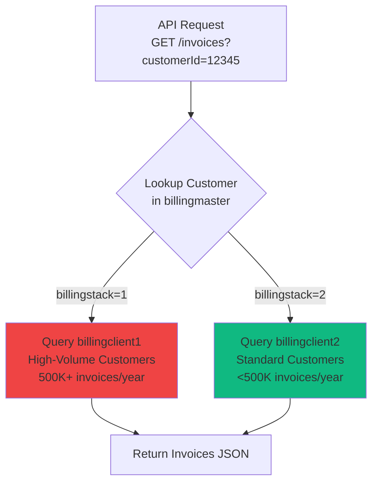

**Key Files:**
- `ig70/models/DbFactory.php` — Stack routing logic
- `ig70/controllers/InvoiceController.php` — API endpoints
- `ig70/models/Invoice.php` — Data model

---

## 2️⃣ **CC (Client Connect) - Supplier Admin Portal**

### **High-Level Architecture**

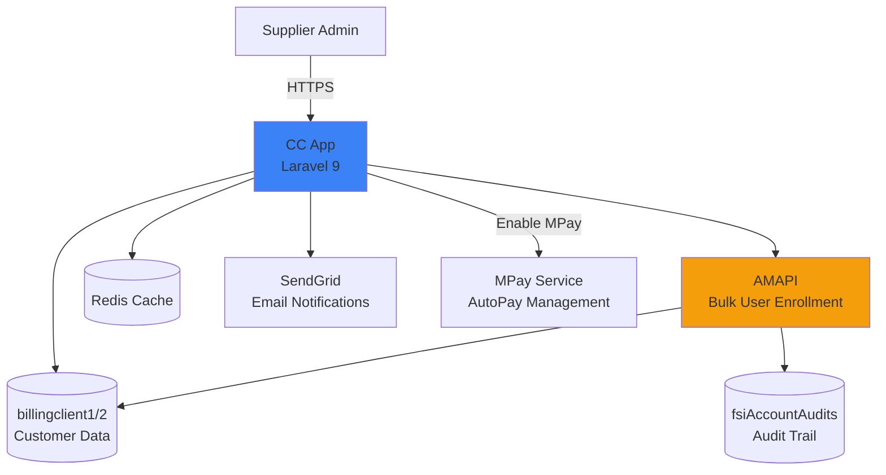

**One-Liner:**
> "CC = Supplier admin portal where suppliers manage customer accounts, enable MPay (AutoPay), and bulk-onboard users via AMAPI — integrates with EIC for customer-facing workflows."

**Key Files:**
- `application/cc/Controllers/AccountController.php` — Account management
- `application/cc/Controllers/AMAPIController.php` — Bulk enrollment
- `application/cc/Models/Account.php` — Data model

---

## 3️⃣ **CSR (Customer Settings Repository)**

### **3-Layer Caching Architecture**

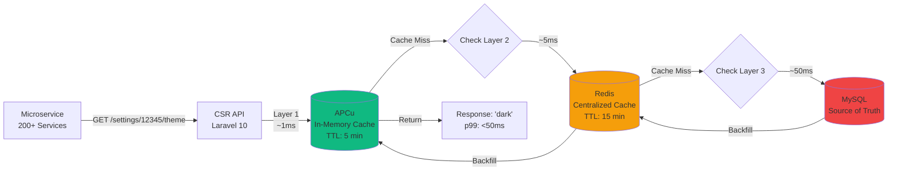

**Cache Invalidation (Version-Based)**

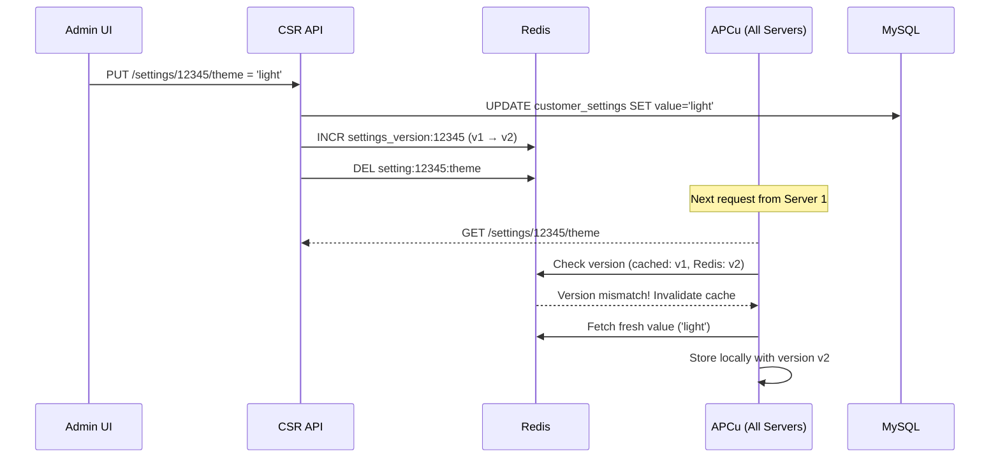

**One-Liner:**
> "CSR = Settings microservice serving 200+ downstream services with <50ms p99 latency via 3-layer caching (APCu → Redis → MySQL) and version-based invalidation across all servers."

**Key Files:**
- `application/csr/Controllers/SettingsController.php` — API endpoints
- `application/csr/Services/CacheService.php` — 3-layer caching logic
- `application/csr/Models/CustomerSetting.php` — Data model

---

## 4️⃣ **WCL (Web Communication Layer) - Integration Microservice**

### **High-Level Architecture**

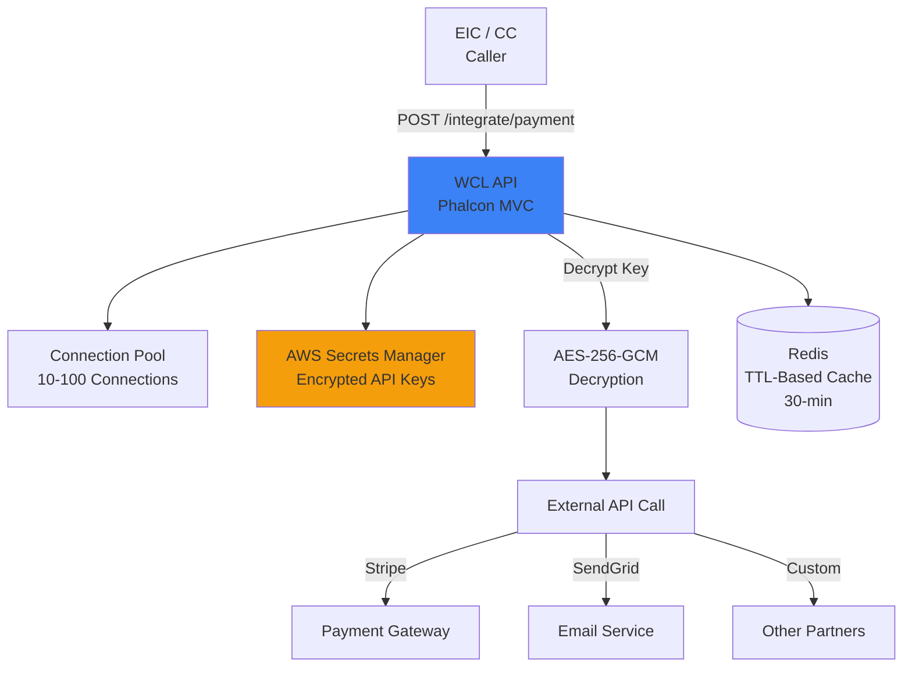

**Connection Pooling Logic**

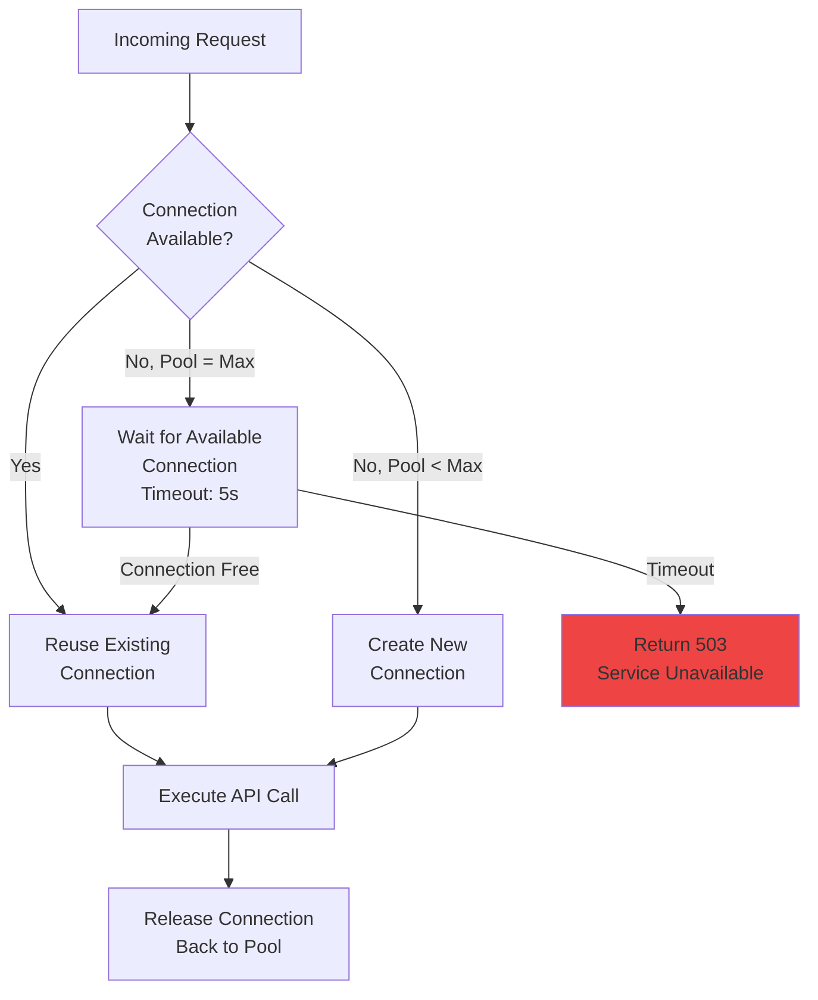

**One-Liner:**
> "WCL = Integration microservice routing calls to 20+ external APIs (payment gateways, email, etc.) with encrypted key storage (AWS Secrets Manager), connection pooling (prevent exhaustion), and TTL-based caching (reduce redundant calls)."

**Key Files:**
- `app/controllers/IntegrationController.php` — API proxy
- `app/services/ConnectionPool.php` — Connection management
- `app/services/EncryptionService.php` — Key decryption

---

## 5️⃣ **MPay (Managed Pay) - Supplier-Level AutoPay**

### **Idempotency Pattern**

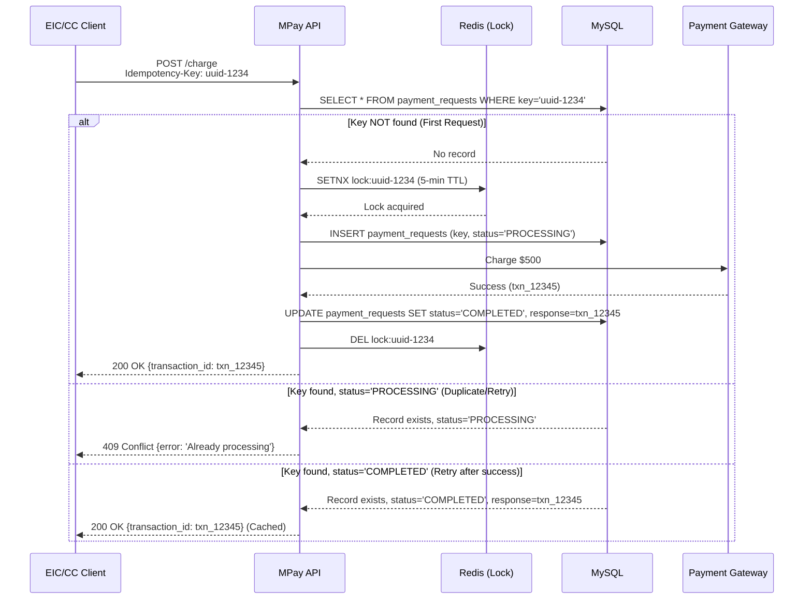

**One-Liner:**
> "MPay = Supplier-managed AutoPay service with idempotency pattern (Redis lock + DB state machine) preventing duplicate charges — reduced disputes by 80% via SETNX locking and status tracking (PROCESSING → COMPLETED → FAILED)."

**Key Files:**
- `app/controllers/PaymentController.php` — Idempotency logic
- `app/services/PaymentGatewayService.php` — Stripe/PayPal integration

---

## 6️⃣ **AMAPI (Account Management API) - Bulk Enrollment**

### **Bulk Insert Flow**

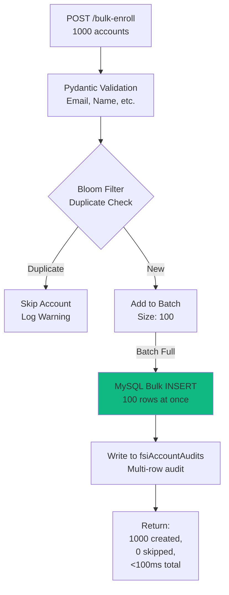

**One-Liner:**
> "AMAPI = Bulk account enrollment API processing 50K+ accounts/month with <100ms per account via batching (100 rows/INSERT), Bloom filter duplicate detection, and multi-layer audit logging (fsiAccountAudits)."

**Key Files:**
- `app/controllers/BulkEnrollController.php` — Batch processing
- `app/services/BloomFilterService.php` — Duplicate detection

---

## 7️⃣ **Biscuit (inv-bt-invoicing-ai) - AI-Assisted Triage**

### **Claude AI Skills Architecture**

```mermaid
graph TB
    User[Karthik<br/>NJQRT Engineer] -->|Invoke Skill| Claude[Claude Code<br/>AI Assistant]
    
    Claude --> Skill1[/karthik-triage<br/>Full NJQRT Workflow]
    Claude --> Skill2[/db-query<br/>Safe MySQL Gateway]
    Claude --> Skill3[/developer<br/>App Context Loader]
    Claude --> Skill4[/researcher<br/>Codebase Analysis]
    
    Skill1 --> Jira[Atlassian MCP<br/>Fetch Ticket]
    Skill1 --> CodeReview[GitHub MCP<br/>PR Analysis]
    Skill1 --> DB[MySQL MCP<br/>Query Production]
    
    Skill2 --> Gateway[db-query.ps1<br/>Docker + MySQL Client]
    Gateway --> ProdDB[(Production DB<br/>Read-Only)]
    
    Skill3 --> RepoScan[Scan Repo<br/>Find Active Modules]
    Skill4 --> DependencyMap[Map Dependencies<br/>Call Graph]
    
    Skill1 --> RCADraft[Generate RCA<br/>5-Field Jira Template]
    
    RCADraft --> JiraPost[Post to Jira<br/>via Atlassian MCP]
    
    style Claude fill:#3b82f6
    style Skill1 fill:#f59e0b
```

**Timeline Reconstruction (Security Investigation)**

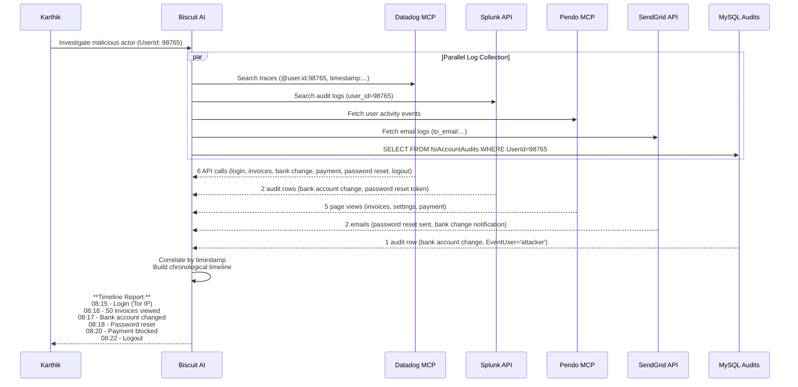

**One-Liner:**
> "Biscuit = AI-powered NJQRT assistant (Claude skills + FastAPI) automating ticket triage, codebase investigation, timeline reconstruction, and Jira posting — reduced incident resolution time by 40% via parallel log collection from 5 monitoring systems."

**Key Files:**
- `skills/workflows/karthik-triage/SKILL.md` — Triage orchestration
- `skills/utility/db-query/db-query.ps1` — Safe MySQL gateway
- `skills/workflows/bt-invoicing-qrt-post/SKILL.md` — Jira posting template

---

## 8️⃣ **Payment Repo (pay-workflow-integration-service) - .NET Payment Orchestration**

### **High-Level Architecture**

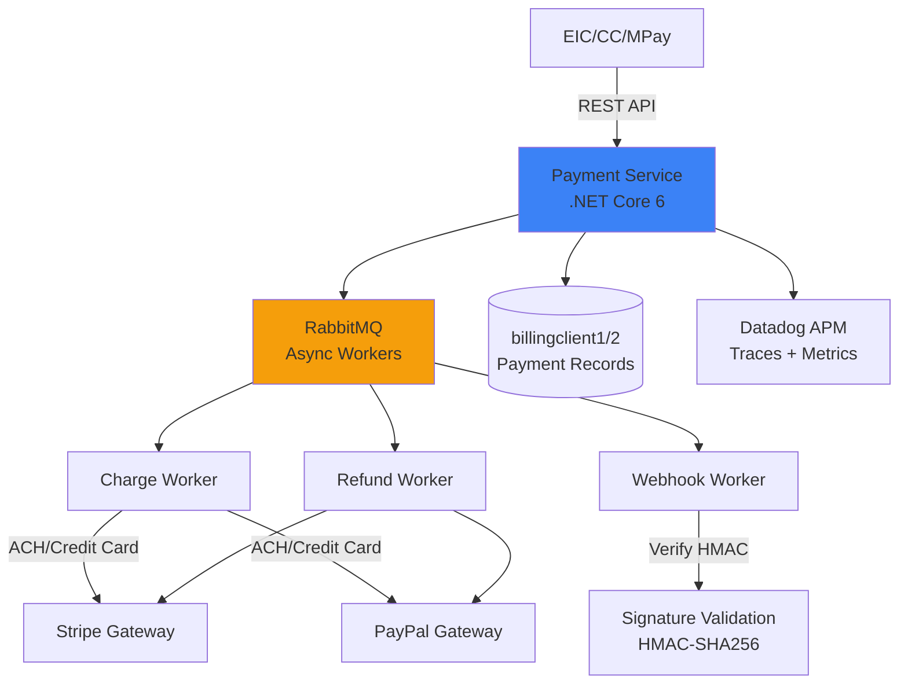

**Webhook Signature Validation Flow**

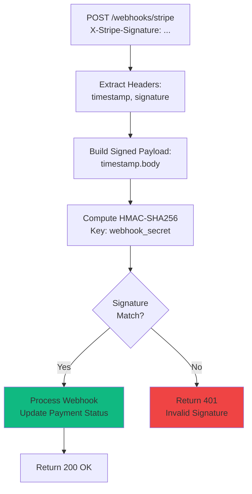

**One-Liner:**
> "Payment repo = .NET Core microservice orchestrating ACH/credit card charges via Stripe/PayPal with async workers (RabbitMQ), webhook HMAC validation (prevent replay attacks), and Datadog APM tracing — you debugged cross-team issues via Claude AI code analysis."

**Key Files:**
- `PaymentService/Controllers/PaymentController.cs` — API endpoints
- `PaymentService/Services/StripeService.cs` — Stripe integration
- `PaymentService/Workers/ChargeWorker.cs` — Async payment processing
- `PaymentService/Services/WebhookValidator.cs` — HMAC signature validation

---

## 🎯 **For Interviews: Architecture Questions**

**Q: "Explain EIC's database sharding strategy."**
> "EIC uses 2-stack sharding: `billingclient1` for high-volume customers (500K+ invoices/year) and `billingclient2` for standard customers. Routing logic queries `billingmaster.BillingStack` column to determine which MySQL instance to hit — prevents hot-spotting on a single database and allows independent scaling."

**Q: "How does CSR achieve <50ms p99 latency serving 200+ microservices?"**
> "3-layer caching: APCu (in-memory, 5-min TTL, ~1ms) → Redis (centralized, 15-min TTL, ~5ms) → MySQL (source of truth, ~50ms). Version-based invalidation ensures all servers invalidate stale APCu caches when settings change — INCR `settings_version` in Redis, next request checks version mismatch and refreshes."

**Q: "What's the idempotency pattern in MPay?"**
> "Redis SETNX lock + MySQL state machine. Client sends `Idempotency-Key: uuid-1234` → (1) Check DB for existing request, (2) If not found, acquire Redis lock, (3) INSERT with status='PROCESSING', (4) Call payment gateway, (5) UPDATE status='COMPLETED', (6) Release lock. Duplicate requests return cached result or 409 Conflict if still processing — reduced disputes 80%."

**Q: "How does Biscuit (AI assistant) reconstruct timelines for security investigations?"**
> "Parallel log collection from 5 sources (Datadog, Splunk, Pendo, SendGrid, MySQL audits) using their respective APIs/MCPs, then correlate events by timestamp to build a chronological timeline. For example: 08:15 Login (Datadog) → 08:16 Invoices viewed (Pendo) → 08:17 Bank changed (MySQL audit) → 08:18 Password reset (SendGrid) → 08:20 Payment blocked (Datadog) → customer report generated in <60 minutes."

---

**NEXT:** Interactive HTML course pages with quizzes + flashcards!