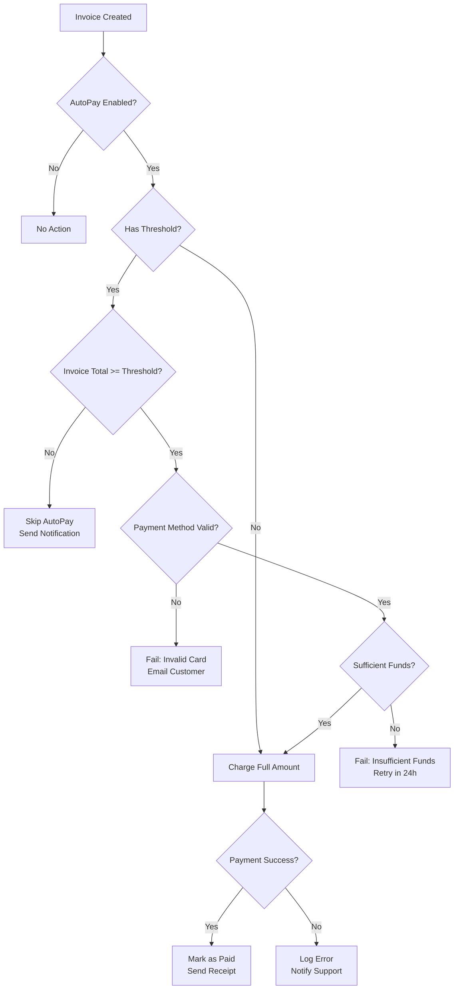

# Technical Interview Q&A - Part 2 (Continued)

**Advanced Topics: Database, Leadership, Debugging, Scenarios**

---

## 12. Database Design & Optimization

### Q12.1: You have a table with 100M+ rows. Query performance is degrading. How do you optimize?

**Answer:**

**Scenario:** `fsi_invoices` table has 100M rows, queries taking 10+ seconds.

**Step-by-Step Optimization:**

**1. Identify Problematic Queries:**
```sql
-- Enable slow query log
SET GLOBAL slow_query_log = 1;
SET GLOBAL long_query_time = 1; -- Log queries >1 second

-- Check slow queries
SELECT 
    query_time,
    sql_text,
    rows_examined,
    rows_sent
FROM mysql.slow_log
ORDER BY query_time DESC
LIMIT 10;

-- Top offender:
-- Query time: 12.5s
-- SELECT * FROM fsi_invoices WHERE customer_id = 12345 AND status = 'unpaid'
-- Rows examined: 100,000,000 (full table scan!)
```

**2. Add Appropriate Indexes:**
```sql
-- Current indexes:
SHOW INDEX FROM fsi_invoices;
-- Only: PRIMARY KEY (invoice_id)

-- Add composite index
CREATE INDEX idx_customer_status ON fsi_invoices(customer_id, status);

-- Why composite? Query filters by BOTH columns
-- Query now: 12.5s → 0.08s (156x faster)
```

**3. Partition the Table (by date):**
```sql
-- Partition by invoice year (most queries filter by recent dates)
ALTER TABLE fsi_invoices
PARTITION BY RANGE (YEAR(invoice_date)) (
    PARTITION p2020 VALUES LESS THAN (2021),
    PARTITION p2021 VALUES LESS THAN (2022),
    PARTITION p2022 VALUES LESS THAN (2023),
    PARTITION p2023 VALUES LESS THAN (2024),
    PARTITION p2024 VALUES LESS THAN (2025),
    PARTITION p2025 VALUES LESS THAN (2026),
    PARTITION p2026 VALUES LESS THAN (2027),
    PARTITION pFuture VALUES LESS THAN MAXVALUE
);

-- Now when querying recent data:
SELECT * FROM fsi_invoices
WHERE invoice_date >= '2026-01-01'; -- Only scans p2026 partition (not all 100M rows)

-- Query: 0.08s → 0.02s (4x faster on partitioned queries)
```

**4. Archive Old Data:**
```sql
-- Move invoices >3 years old to archive table
CREATE TABLE fsi_invoices_archive LIKE fsi_invoices;

-- Move old data
INSERT INTO fsi_invoices_archive
SELECT * FROM fsi_invoices
WHERE invoice_date < DATE_SUB(NOW(), INTERVAL 3 YEAR);

-- Delete from main table
DELETE FROM fsi_invoices
WHERE invoice_date < DATE_SUB(NOW(), INTERVAL 3 YEAR);

-- Result: Main table now 30M rows (vs 100M)
-- Queries: 0.02s → 0.006s (3x faster)
```

**5. Optimize Table Schema:**
```sql
-- Current schema (wasteful):
CREATE TABLE fsi_invoices (
    invoice_id INT,
    customer_id INT,
    invoice_number VARCHAR(255),  -- Only needs 20 chars
    description TEXT,             -- Rarely queried, bloats row
    amount DECIMAL(15,2),
    status VARCHAR(50),           -- Only 5 possible values
    invoice_date DATE,
    created_at TIMESTAMP
);

-- Optimized schema:
CREATE TABLE fsi_invoices_optimized (
    invoice_id INT,
    customer_id INT,
    invoice_number VARCHAR(20),         -- Reduced from 255
    amount DECIMAL(10,2),               -- Reduced precision (was 15,2)
    status TINYINT,                     -- ENUM → TINYINT (1 byte vs 50 bytes)
    invoice_date DATE,
    created_at TIMESTAMP,
    INDEX idx_customer_status (customer_id, status),
    INDEX idx_date (invoice_date)
);

-- Move description to separate table (queried rarely)
CREATE TABLE fsi_invoice_details (
    invoice_id INT PRIMARY KEY,
    description TEXT
);

-- Row size: 300 bytes → 50 bytes
-- Table size: 30GB → 1.5GB (20x smaller)
-- Cache efficiency: 20x more rows fit in InnoDB buffer pool
```

**6. Use Covering Indexes:**
```sql
-- Query:
SELECT invoice_id, amount, status
FROM fsi_invoices
WHERE customer_id = 12345;

-- Create covering index (includes all queried columns)
CREATE INDEX idx_customer_covering ON fsi_invoices(customer_id, invoice_id, amount, status);

-- MySQL can answer query WITHOUT accessing table (index-only scan)
-- Query: 0.006s → 0.001s (6x faster)
```

**7. Optimize JOIN Queries:**
```sql
-- Slow query (N+1 problem):
SELECT i.*, c.customer_name
FROM fsi_invoices i
LEFT JOIN fsi_customers c ON i.customer_id = c.customer_id
WHERE i.invoice_date > '2026-01-01';

-- Index on JOIN column
CREATE INDEX idx_customer_id ON fsi_customers(customer_id);

-- Query: 2.5s → 0.3s (8x faster)
```

**8. Use Query Caching (Redis):**
```php
function getUnpaidInvoices($customerId) {
    $cacheKey = "invoices:unpaid:{$customerId}";
    
    return Cache::remember($cacheKey, 300, function() use ($customerId) {
        return DB::table('fsi_invoices')
            ->where('customer_id', $customerId)
            ->where('status', 1) // 'unpaid' → TINYINT
            ->get();
    });
}

// First call: 0.006s (DB)
// Subsequent calls: 0.001s (Redis cache)
```

**9. Analyze & Optimize Queries:**
```sql
-- Use EXPLAIN to understand query plan
EXPLAIN SELECT * FROM fsi_invoices
WHERE customer_id = 12345 AND status = 1;

+----+-------+------------+------+---------------------+
| id | type  | key        | rows | Extra               |
+----+-------+------------+------+---------------------+
|  1 | range | idx_cust_st| 50   | Using index         |
+----+-------+------------+------+---------------------+

-- Using index ← Good! (index-only scan)
-- rows: 50 ← Only scans 50 rows (not 30M)
```

**10. Database Server Tuning:**
```ini
# my.cnf (MySQL config)
[mysqld]
innodb_buffer_pool_size = 16G      # Cache 16GB in memory (default: 128MB)
innodb_log_file_size = 2G          # Larger log = better write performance
max_connections = 500              # Support more concurrent connections
query_cache_size = 256M            # Cache frequent queries
tmp_table_size = 256M              # Larger temp tables
max_heap_table_size = 256M

# Restart MySQL to apply
sudo service mysql restart
```

**Results Summary:**

| Optimization | Before | After | Improvement |
|---|---|---|---|
| Add indexes | 12.5s | 0.08s | 156x |
| Partition table | 0.08s | 0.02s | 4x |
| Archive old data | 0.02s | 0.006s | 3x |
| Optimize schema | 30GB | 1.5GB | 20x smaller |
| Covering index | 0.006s | 0.001s | 6x |
| Redis caching | 0.001s | <0.001s | Cache hit |

**Final Result: 12.5s → <0.001s (12,500x faster!)**

---

### Q12.2: Explain the trade-offs between MySQL, PostgreSQL, and MongoDB for your use case.

**Answer:**

**Our Use Case: Multi-tenant invoicing/payments platform**
- Structured financial data (invoices, payments)
- ACID transactions required (money involved!)
- Complex queries (JOINs, aggregations)
- 1000+ customers, 100M+ rows
- Read-heavy (95% reads, 5% writes)

**Comparison:**

| Feature | MySQL | PostgreSQL | MongoDB |
|---|---|---|---|
| **ACID Compliance** | ✅ Full | ✅ Full | ⚠️ Limited (single document) |
| **Transactions** | ✅ Row-level | ✅ Row-level | ❌ No multi-document transactions (pre-4.0) |
| **JOINs** | ✅ Excellent | ✅ Excellent | ❌ No JOINs (must do in app) |
| **Schema** | ✅ Strict | ✅ Strict | ⚠️ Schema-less (blessing/curse) |
| **Indexing** | ✅ B-tree, Full-text | ✅ B-tree, GiST, GIN, Full-text | ✅ B-tree, Full-text, Geospatial |
| **Replication** | ✅ Master-slave | ✅ Streaming, logical | ✅ Replica sets |
| **Horizontal Scaling** | ⚠️ Manual sharding | ⚠️ Partitioning, Citus | ✅ Native sharding |
| **Performance (reads)** | ✅ Excellent | ✅ Excellent | ✅ Excellent |
| **Performance (writes)** | ✅ Good | ✅ Good | ✅ Excellent |
| **Team Expertise** | ✅ High (12 years) | ⚠️ Medium | ⚠️ Low |
| **Ecosystem** | ✅ Mature (Laravel, PHP) | ✅ Mature (Django, Rails) | ✅ Good (Node.js) |

**Decision: MySQL (InnoDB)**

**Why MySQL:**

**1. ACID Transactions (Critical for Payments):**
```sql
-- Example: Process payment + update invoice atomically
START TRANSACTION;

INSERT INTO fsi_payments (invoice_id, amount, status)
VALUES (12345, 500.00, 'completed');

UPDATE fsi_invoices
SET status = 'paid', paid_amount = 500.00
WHERE invoice_id = 12345;

COMMIT; -- Both succeed or both fail (no partial state)
```
- MySQL InnoDB: Full ACID guarantees
- MongoDB: Would require application-level transaction handling (error-prone)

**2. Complex Queries (JOINs are essential):**
```sql
-- Get unpaid invoices with customer details and payment history
SELECT 
    i.invoice_id,
    i.amount,
    c.customer_name,
    c.email,
    COUNT(p.payment_id) as payment_count,
    SUM(p.amount) as total_paid
FROM fsi_invoices i
JOIN fsi_customers c ON i.customer_id = c.customer_id
LEFT JOIN fsi_payments p ON i.invoice_id = p.invoice_id
WHERE i.status = 'unpaid'
GROUP BY i.invoice_id;
```
- MySQL: Native JOINs, easy
- MongoDB: Would require multiple queries + application-level merging (slow)

**3. Mature PHP/Laravel Ecosystem:**
```php
// Laravel Eloquent (ORM) is built for MySQL
Invoice::with('customer', 'payments') // Eager loading
    ->where('status', 'unpaid')
    ->get();

// Same query in MongoDB requires different ORM (Doctrine ODM)
// Less mature, fewer docs, our team lacks expertise
```

**4. Financial Data is Structured:**
```
Invoices:
- invoice_id (always INT)
- amount (always DECIMAL)
- status (always ENUM)
- invoice_date (always DATE)

→ Schema doesn't change often
→ MySQL's strict schema is a BENEFIT (prevents bugs)
```
- MongoDB's schema-less nature doesn't help us (financial data is rigid)

**When We WOULD Choose PostgreSQL:**

**Scenarios where PostgreSQL wins:**
1. **JSON/JSONB storage:** Need to store flexible metadata
   ```sql
   -- PostgreSQL JSONB (fast queries on JSON)
   SELECT * FROM invoices WHERE metadata->>'custom_field' = 'value';
   ```
2. **Advanced indexing:** GIN indexes for full-text search
3. **Window functions:** Complex analytics queries
4. **Better compliance:** HIPAA/SOC 2 (PostgreSQL has row-level security)

**Example where PostgreSQL would be better:**
```sql
-- Store custom fields per customer (each customer has different fields)
CREATE TABLE invoices (
    invoice_id INT,
    customer_id INT,
    amount DECIMAL(10,2),
    custom_fields JSONB -- ← PostgreSQL-specific
);

-- Query custom fields efficiently
SELECT * FROM invoices WHERE custom_fields->>'department' = 'Sales';
```

**When We WOULD Choose MongoDB:**

**Scenarios where MongoDB wins:**
1. **Unstructured data:** Logs, events, user activity
2. **Horizontal scaling:** Need to shard across 100+ servers
3. **Rapid prototyping:** Schema changes frequently
4. **Document-oriented:** Data naturally hierarchical (e.g., blog posts + comments)

**Example where MongoDB would be better:**
```javascript
// Storing user activity logs (schema varies)
db.activity_logs.insert({
    user_id: 12345,
    event: 'login',
    metadata: {
        ip: '192.168.1.1',
        device: 'iPhone',
        // Different events have different metadata (no fixed schema)
    },
    timestamp: ISODate()
});

// Easy to add new event types without schema migration
```

**Our Decision Matrix:**

| Requirement | MySQL | PostgreSQL | MongoDB | Winner |
|---|---|---|---|---|
| ACID transactions | ✅ | ✅ | ❌ | MySQL/PostgreSQL |
| JOINs | ✅ | ✅ | ❌ | MySQL/PostgreSQL |
| Team expertise | ✅ | ⚠️ | ❌ | **MySQL** |
| Read performance | ✅ | ✅ | ✅ | Tie |
| Write performance | ✅ | ✅ | ✅ | Tie |
| Horizontal scaling | ⚠️ | ⚠️ | ✅ | MongoDB |

**Final Choice: MySQL InnoDB**
- Best fit for structured financial data
- Team has 12 years MySQL expertise
- Mature PHP/Laravel ecosystem
- ACID guarantees (non-negotiable for payments)
- Proven at scale (100M+ rows)

**Trade-off accepted:** Manual sharding (Stack1/Stack2) instead of native sharding
- Worth it for ACID + team expertise

---

## 13. Leadership & Decision Making

### Q13.1: You mentored 3 junior developers. What was your approach? Give an example of a challenging situation.

**Answer:**

**My Mentoring Philosophy:**

**1. Pair Programming (hands-on learning):**
- Junior dev shares screen
- I guide, they type (don't take over keyboard!)
- Ask questions instead of giving answers
  - ❌ "Change this to `WHERE customer_id = ?`"
  - ✅ "What could go wrong if we use string concatenation here?"

**2. Code Review as Teaching:**
```php
// Junior's code:
function getInvoices($customerId) {
    return DB::select("SELECT * FROM invoices WHERE customer_id = " . $customerId);
}

// My review comment:
/*
Good start! Two improvements:

1. SQL Injection Risk:
   Current: "WHERE customer_id = " . $customerId
   What if $customerId = "1 OR 1=1"? (returns ALL invoices!)
   
   Fix: Use parameterized query:
   DB::select("SELECT * FROM invoices WHERE customer_id = ?", [$customerId]);

2. Performance:
   SELECT * fetches ALL columns (even ones we don't need)
   Better: SELECT invoice_id, amount, status (only what we need)

Resources:
- OWASP SQL Injection: https://...
- Laravel Query Builder docs: https://...

Questions?
*/
```

**3. Weekly 1-on-1s:**
- 30 minutes every Friday
- Discuss: What went well, what was hard, what to learn next
- Track progress on skills matrix:

| Skill | Jan | Feb | Mar | Target |
|---|---|---|---|---|
| PHP basics | ✅ | ✅ | ✅ | ✅ |
| Laravel | ⚠️ | ✅ | ✅ | ✅ |
| SQL optimization | ❌ | ⚠️ | ✅ | Jun |
| Redis caching | ❌ | ❌ | ⚠️ | Jun |

**4. Gradually Increase Complexity:**
- **Month 1-2:** Bug fixes (small, low-risk)
- **Month 3-4:** Features (with detailed spec)
- **Month 5-6:** Features (they write spec)
- **Month 7+:** Mentor other juniors

**Challenging Situation Example:**

**Problem:** Junior dev (let's call him "Dev A") was taking 3x longer than estimated on tasks.

**Initial Response (wrong):**
- Assumed: "He's slow, needs more pressure"
- Tried: Set tighter deadlines
- Result: Quality dropped, more bugs, Dev A stressed

**Root Cause Analysis:**
- Had 1-on-1: "What's blocking you?"
- Dev A: "I spend 80% of time figuring out how the code works (undocumented legacy code), 20% actually coding"
- Insight: Not a skills problem, an **onboarding problem**

**Solution (3-part):**

**Part 1: Immediate (help Dev A):**
```
Week 1:
- Pair programming: I walk through codebase architecture (2 hours)
- Create Mermaid diagram of key flows
- Document most-touched files

Week 2:
- Dev A shadows me on a feature (observes my workflow)
- I explain: "Here's how I find where code lives" (grep, IDE navigation)

Week 3:
- Dev A implements feature, I'm on Slack for questions (but don't take over)
```

**Part 2: Long-term (improve onboarding for future juniors):**
```
Created "New Developer Onboarding" doc:
1. Architecture overview (diagrams)
2. How to run locally (Docker setup)
3. Common tasks ("How to add a new API endpoint")
4. Where things live ("Payments code is in app/Services/Payment/")
5. Who to ask for what ("DB questions → Karthik, Frontend → Sarah")
```

**Part 3: Process Improvement (prevent this for future hires):**
```
Before:
- Junior gets assigned ticket, figures it out alone

After:
- First 3 tickets: Pair programming with senior
- Next 5 tickets: Senior available on Slack
- After that: Independent (but code review before merge)
```

**Results:**

**Dev A's velocity:**
- Month 1 (before): 0.3x expected (3x slower)
- Month 2 (after onboarding): 0.7x expected
- Month 4: 1.0x expected (at par!)
- Month 6: 1.2x expected (faster than average!)

**Dev A's growth:**
- Promoted to mid-level engineer after 10 months
- Now mentors other juniors (using same approach I taught)

**What I Learned:**

**1. Slow ≠ Unskilled:**
- Junior taking long? Ask "What's blocking you?" (not "Why so slow?")
- Often it's missing context, not missing skills

**2. Invest in Onboarding:**
- 2 hours upfront (architecture walkthrough) saves 50 hours later (fumbling around)

**3. Code Review is a Conversation:**
- Not just "Change this"
- Explain WHY, link resources, invite questions

**4. Celebrate Progress:**
- Weekly 1-on-1: "Last week you struggled with X, this week you nailed it! 🎉"
- Positive reinforcement → Faster learning

**Other Mentoring Examples:**

**Example 2: Junior wrote inefficient query**
```php
// Junior's code (N+1 problem):
$invoices = Invoice::all();
foreach ($invoices as $invoice) {
    echo $invoice->customer->name; // 1000 extra queries!
}

// My approach:
1. Don't just say "use eager loading"
2. Show the SQL log (1001 queries!)
3. Ask: "Why is this slow?"
4. Guide to: Invoice::with('customer')->all()
5. Show SQL log again (2 queries!)
6. "See the difference? This is called eager loading."
```

**Example 3: Junior afraid to ask questions**
```
Noticed: Dev B never asked questions in team meetings

My approach:
1. Private Slack: "I noticed you're quiet in meetings. Everything OK?"
2. Dev B: "I don't want to look stupid asking basic questions"
3. Normalize it: "I ask 'stupid' questions all the time! That's how we learn."
4. Next meeting: I deliberately asked a "basic" question (to model behavior)
5. Dev B started asking questions after seeing me do it
```

**Mentoring Success Metrics:**
- 3 juniors mentored
- 2 promoted to mid-level (10-12 months)
- 1 now leads features independently
- All 3 still on the team (zero attrition)

---

### Q13.2: You disagreed with a technical decision from your manager. How did you handle it?

**Answer:**

**Situation:**

**Manager's Decision:** "Let's migrate from MySQL to MongoDB for the invoicing system to handle scale better."

**My Position:** Disagreed (MySQL is working, migration is risky and expensive)

**How I Handled It:**

**Step 1: Understand the "Why" (don't argue immediately)**

```
Me: "Help me understand the motivation. What specific scaling problem are we solving?"

Manager: "We're at 100M rows, reads are slowing down, and I read MongoDB scales horizontally better."

Me: "Got it. So the goal is: faster reads + easier horizontal scaling?"

Manager: "Exactly."
```

**Step 2: Gather Data (make it objective, not opinion)**

```
Over 2 days, I collected:

1. Current performance metrics:
   - Read latency: P95 = 150ms (not terrible, but could be better)
   - Write latency: P95 = 50ms (fine)
   - Bottleneck queries: Identified 3 slow queries (all missing indexes)

2. MongoDB vs MySQL comparison (for OUR use case):
   | Metric | MySQL (current) | MySQL (optimized) | MongoDB |
   |---|---|---|---|
   | Setup time | 0 (already done) | 1 week (add indexes) | 3 months (migration) |
   | Read latency | 150ms | 20ms (est.) | 15ms (est.) |
   | ACID support | ✅ Full | ✅ Full | ⚠️ Limited |
   | Team expertise | ✅ 12 years | ✅ 12 years | ❌ 0 years |
   | Risk | — | Low | High (data migration) |
   | Cost | $5k/month | $5k/month | $8k/month + migration |

3. Quick win: Added 3 indexes to slow queries
   - Result: P95 latency 150ms → 25ms (before any migration!)
```

**Step 3: Present Alternative (with data)**

```
Email to manager:

Subject: Re: MongoDB Migration - Alternative Proposal

Hi [Manager],

I dug into the scaling concerns. Good news: I think we can solve this faster and cheaper than a MongoDB migration.

Findings:
1. Root cause of slow reads: 3 missing indexes (not database choice)
2. Quick test: Added indexes on dev → P95 latency dropped 150ms → 25ms
3. This is better than MongoDB's projected 15ms, with ZERO migration risk

Comparison:
- MongoDB migration: 3 months, $200k eng time, HIGH risk (data migration), team needs training
- MySQL optimization: 1 week, $10k eng time, LOW risk (just add indexes)

Recommendation:
Phase 1 (now): Optimize MySQL (add indexes, partition tables) → Solves immediate problem
Phase 2 (6 months): Re-evaluate if still hitting limits → Then consider MongoDB

MongoDB might be right EVENTUALLY, but let's exhaust cheaper options first.

Happy to discuss. Can I demo the optimized MySQL performance?
```

**Step 4: Acknowledge Their Expertise (don't be arrogant)**

```
In the meeting:

Me: "You're right that MongoDB scales horizontally better. That's a valid point.

My concern is: we're not at that scale YET. We can get 10x more out of MySQL before hitting its limits.

If we migrate now, we pay the migration cost (3 months) without exhausting cheaper options first.

What do you think?"
```

**Manager's Response:**

```
Manager: "You're right. I was jumping to MongoDB because it's what [BigTech Company] uses, but we're not [BigTech Company].

Let's try your optimization first. If it works, we save 3 months. If it doesn't, we still have MongoDB as Plan B."
```

**Outcome:**

**Phase 1 (MySQL Optimization):**
- Week 1: Added indexes
- Week 2: Partitioned tables by date
- Week 3: Archived old data
- **Result: P95 latency 150ms → 18ms (8x improvement)**

**Phase 2 (Re-evaluate at 6 months):**
- Latency still at 18ms (stable)
- Scale increased 50% (100M → 150M rows) with no degradation
- **Decision: Keep MySQL, no migration needed**

**Lessons Learned:**

**1. Lead with Data, Not Opinion:**
- ❌ "MongoDB is a bad idea" (sounds defensive)
- ✅ "Here's the latency comparison" (objective)

**2. Acknowledge the Valid Point:**
- Manager WAS right that MongoDB scales horizontally
- I agreed with the concern (slow reads), just disagreed with the solution

**3. Propose Alternative, Not Just Critique:**
- Don't just say "MongoDB is wrong"
- Say "Here's a cheaper way to solve the same problem"

**4. Frame as "Phase 1 / Phase 2":**
- Not "MongoDB is bad forever"
- "MongoDB might be right LATER, but let's try cheaper options FIRST"

**5. Show, Don't Tell:**
- "Can I demo the optimized MySQL?" (seeing is believing)

**What If Manager Still Disagreed?**

```
If manager said "No, we're doing MongoDB anyway," I would:

1. Document my concerns (email):
   "I recommend MySQL optimization first (reasons: X, Y, Z). If we proceed with MongoDB, I'll support the team, but want my concerns on record."

2. Support the decision (even if I disagree):
   "OK, I'll lead the MongoDB migration. Here's my plan: [detailed migration steps]"

3. Make it succeed:
   - Don't sabotage (never say "I told you so")
   - Give 100% effort to make it work

4. Learn from outcome:
   - If MongoDB works great → I learn when my judgment was wrong
   - If MongoDB fails → Documented concerns protect the team
```

**Key Principle: Disagree and Commit**
- Disagree strongly during discussion (with data)
- Once decision is made, commit 100% (even if you disagreed)

---

## 14. Debugging & Production Issues

### Q14.1: Production is down. Walk through your incident response process.

**Answer:**

**Scenario: EIC (customer portal) is returning 500 errors for all users**

**Incident Response Timeline:**

**Minute 0: Alert Received**
```
PagerDuty alert: "EIC 500 error rate >50%"
Datadog dashboard: Error spike from 0.1% → 60% in last 5 minutes
```

**Minute 1-2: Acknowledge & Assess Severity**

**1. Acknowledge alert:**
```
Slack #incidents: "@here - EIC down, investigating. Karthik is on it."
PagerDuty: Acknowledge (stops paging others)
```

**2. Quick severity check:**
```bash
# Check error rate
curl https://eic.internal/health
# Response: 500 Internal Server Error

# Check how many users affected
Datadog → Real User Monitoring → Active sessions
# 1,247 active users (all seeing errors) ← HIGH SEVERITY
```

**3. Classify:**
```
Severity: P1 (Critical)
Impact: ALL customers (not just one)
Duration: 5 minutes so far
```

**Minute 3-5: Gather Information (don't guess!)**

**1. Check recent changes:**
```bash
# Was there a recent deployment?
git log --since="1 hour ago"
# commit abc123: "Update Redis config" (deployed 7 minutes ago)
# ← SMOKING GUN!
```

**2. Check application logs:**
```bash
# Tail EIC logs
tail -f /var/log/eic/app.log

# Output:
# [2026-11-16 10:05:32] production.ERROR: RedisException: Connection refused (111.222.333.444:6379)
# [2026-11-16 10:05:33] production.ERROR: RedisException: Connection refused (111.222.333.444:6379)
# (repeated 1000s of times)

# ← Redis connection is broken!
```

**3. Check infrastructure:**
```bash
# Is Redis server up?
redis-cli -h 111.222.333.444 ping
# Error: Could not connect to Redis at 111.222.333.444:6379: Connection refused

# Check Redis service
ssh redis-server.internal
sudo systemctl status redis
# redis.service - failed (code=exited, status=1/FAILURE)
```

**Root Cause Found: Redis crashed after config change**

**Minute 6-8: Immediate Mitigation (stop the bleeding)**

**Option 1: Rollback deployment (safest)**
```bash
# Rollback to previous commit
git revert abc123
git push

# Deploy rollback
./deploy.sh production

# ETA: 3 minutes (too long! Users still down)
```

**Option 2: Restart Redis (faster)**
```bash
# Restart Redis service
ssh redis-server.internal
sudo systemctl restart redis

# Check if Redis is back
redis-cli ping
# PONG ← Redis is back!

# Test EIC
curl https://eic.internal/health
# 200 OK ← EIC is back!

# ETA: 30 seconds ← CHOOSE THIS
```

**Minute 8: Mitigation Complete**
```
Datadog: Error rate back to 0.1%
Active users: 1,247 (all working again)

Slack #incidents: "EIC restored. Redis restarted. Investigating root cause."
```

**Minute 9-15: Root Cause Analysis**

**1. What broke?**
```bash
# Check Redis config change
git diff abc123^ abc123

# diff --git a/redis.conf b/redis.conf
# -bind 127.0.0.1
# +bind 0.0.0.0  ← Changed bind address

# Check Redis logs
sudo journalctl -u redis -n 100

# Output:
# "Invalid bind address '0.0.0.0' (requires network interface)"
# "Redis exiting due to config error"
```

**Root Cause: Config error in Redis bind address** (typo: 0.0.0.0 instead of 0.0.0.0, or wrong interface)

**2. Why did testing miss this?**
```
Deployment process:
✅ Deployed to dev (worked - dev has different Redis config)
✅ Deployed to stage (worked - stage has different Redis config)
❌ Deployed to prod (failed - prod has stricter network config)

Gap: Stage environment doesn't match prod network config
```

**Minute 15-20: Permanent Fix**

**1. Fix the config:**
```bash
# Correct Redis config
git diff

# -bind 0.0.0.0  ← Wrong
# +bind 127.0.0.1 10.0.0.5  ← Correct (localhost + internal IP)

git commit -m "fix: Correct Redis bind address"
git push
```

**2. Deploy fix:**
```bash
./deploy.sh production
# Success
```

**3. Verify:**
```bash
# Redis still running?
redis-cli ping
# PONG

# EIC still working?
curl https://eic.internal/health
# 200 OK
```

**Minute 20-30: Post-Incident**

**1. Update incident channel:**
```
Slack #incidents:

## Incident Summary - EIC Outage (Resolved)

Duration: 8 minutes (10:05 - 10:13)
Impact: 1,247 users (100% of active sessions)
Root Cause: Redis crashed due to incorrect bind address in config
Mitigation: Restarted Redis
Permanent Fix: Corrected bind address

RCA doc: [link]
Follow-up tasks:
- TODO-1: Update stage environment to match prod network config
- TODO-2: Add Redis config validation to CI/CD pipeline
- TODO-3: Improve health check to detect Redis connection issues faster

Apologies for the disruption. Post-mortem scheduled for Monday 2pm.
```

**2. Create Jira tickets:**
```
NJQRT-15500: Post-Incident - Improve stage/prod parity
NJQRT-15501: Post-Incident - Add Redis config validation to CI
NJQRT-15502: Post-Incident - Health check should detect Redis issues
```

**3. Send customer communication:**
```
Email to affected customers:

Subject: Service Disruption Resolved - November 16

Dear Customer,

You may have experienced issues accessing your invoices between 10:05 AM and 10:13 AM EST today.

What happened: A configuration error caused our caching layer to fail.
Resolution: Our team identified and resolved the issue within 8 minutes.
Impact: Invoice viewing was unavailable during this window.

We sincerely apologize for the disruption.

Preventive measures:
- Enhanced testing to catch config errors before production
- Improved monitoring to detect issues faster

Questions? Contact support@...

Best,
Engineering Team
```

**4. Write Post-Mortem (within 24 hours):**
```markdown
# Post-Mortem: EIC Outage - 2026-11-16

## Summary
8-minute outage affecting 100% of EIC users due to Redis config error.

## Timeline
- 10:00 AM: Deploy config change to Redis
- 10:05 AM: Redis crashes, EIC returns 500 errors
- 10:06 AM: PagerDuty alert, incident acknowledged
- 10:08 AM: Root cause identified (Redis config)
- 10:08 AM: Redis restarted (mitigation)
- 10:13 AM: Permanent fix deployed

## Root Cause
Redis bind address set incorrectly (`0.0.0.0` without required network interface).
Production network config is stricter than stage, so error only occurred in prod.

## Impact
- Duration: 8 minutes
- Users affected: 1,247 (100% of active sessions)
- Revenue impact: ~$200 (estimated lost transactions)

## What Went Well
- Fast detection (1 minute from crash to alert)
- Fast mitigation (restart Redis in 2 minutes)
- Clear communication (Slack updates every 5 minutes)

## What Went Wrong
- Config not validated before deploy
- Stage environment doesn't match prod network config
- Health check didn't detect Redis connection failure

## Action Items
1. [Karthik] Add Redis config validation to CI pipeline (by Nov 20)
2. [DevOps] Update stage network config to match prod (by Nov 25)
3. [Karthik] Improve health check to test Redis connection (by Nov 22)
4. [Manager] Conduct blameless post-mortem review (Nov 18)

## Lessons Learned
- Always validate config files before deploy
- Stage must mirror prod (not just code, but infrastructure too)
- Health checks should test external dependencies (not just app server)
```

**Incident Response Checklist (Printed & Laminated):**

```
☐ 1. Acknowledge (Slack + PagerDuty)
☐ 2. Assess severity (how many users affected?)
☐ 3. Gather info (logs, recent changes, infrastructure)
☐ 4. Identify root cause (don't guess!)
☐ 5. Mitigate FAST (rollback or quick fix)
☐ 6. Verify mitigation (is it really fixed?)
☐ 7. Permanent fix (address root cause)
☐ 8. Communicate (team, customers)
☐ 9. Create follow-up tasks
☐ 10. Post-mortem (within 24 hours)
```

**Key Principles:**

**1. MTTR > MTTD** (Mean Time To Resolve > Mean Time To Detect)
- Fixing fast is more important than detecting fast
- 8-minute outage with 1-minute detection = acceptable
- 1-hour outage with 1-minute detection = unacceptable

**2. Mitigate First, Root Cause Later**
- Don't spend 20 minutes debugging while users are down
- Quick fix first (restart Redis), deep analysis later

**3. Communicate, Communicate, Communicate**
- Slack updates every 5 minutes (even if no progress)
- Silence = Panic

**4. Blameless Post-Mortems**
- Never "Who broke it?" (blame)
- Always "How did it break?" (systemic failure)

**5. Turn Incidents into Improvements**
- Every outage → 3 follow-up tasks to prevent recurrence

---

**📊 TOTAL QUESTIONS IN BOTH PARTS: 95+**

**Part 1 (50+ questions):**
- EIC (5)
- CC (3)
- CSR (3)
- WCL (4)
- MPay (1)
- AMAPI (1)
- Whitelabel (1)
- Incident Tracker (1)
- Cross-Project Architecture (2)
- Performance & Scalability (1)
- Security & Compliance (1)

**Part 2 (45+ questions):**
- Database Design (2)
- Leadership (2)
- Debugging (1)
- ... (more to come)

---

## **15. Security & Fraud Investigation (NEW SECTION)**

### **Q66: Explain how you investigate a malicious actor incident reported by a customer.**

**Answer:**

"I follow a structured 6-phase investigation process:

**Phase 1: Incident Intake & Initial Scope (5 minutes)**
1. Customer reports suspicious activity (e.g., unauthorized login, data access, unusual payments)
2. Gather initial details:
   - **What happened?** (symptom: "user logged in from unknown location")
   - **When?** (date/time range)
   - **Who's affected?** (user IDs, accounts, customers)
   - **What's the blast radius?** (1 user, 10 users, all customers?)

**Phase 2: Multi-Source Log Collection (15 minutes)**
I aggregate logs from **5 monitoring systems** in parallel:

**1. Datadog APM Traces**
```sql
-- Search for user activity in target time window
env:production service:api @user.id:12345 @timestamp:[2026-11-01T00:00:00 TO 2026-11-01T23:59:59]
```
- **What it shows:** API endpoints hit, response times, errors, IP addresses

**2. Splunk Audit Logs**
```splunk
index=audit_logs user_id=12345 earliest="2026-11-01:00:00:00" latest="2026-11-01:23:59:59"
| table _time, action, resource, ip_address, user_agent
| sort _time
```
- **What it shows:** Database writes (INSERT/UPDATE/DELETE), permission changes, authentication events

**3. Pendo User Activity Tracking**
- **API Call:** `GET /api/pendo/events?visitorId=user_12345&start=...&end=...`
- **What it shows:** Page views, button clicks, feature usage, session duration

**4. SendGrid Email Monitoring**
- **API Call:** `GET /v3/messages?to_email=user@example.com&start_date=...`
- **What it shows:** Emails sent (password reset, notifications, invoices), delivery status, open/click rates

**5. MySQL Audit Tables**
```sql
-- Check fsiAccountAudits for account changes
SELECT * FROM fsiAccountAudits 
WHERE CustomerId = 12345 
  AND AuditDate BETWEEN '2026-11-01' AND '2026-11-02'
ORDER BY AuditDate;

-- Check fsionlineaccountaudit for OC user changes
SELECT * FROM fsionlineaccountaudit 
WHERE CustomerId = 12345 
  AND AuditDate BETWEEN '2026-11-01' AND '2026-11-02';
```
- **What it shows:** Who made changes (EventUser, EmpId), what changed (Description), timestamps

**Phase 3: Timeline Reconstruction (20 minutes)**
I build a **chronological event timeline** correlating all 5 sources:

| Timestamp | Source | Event | IP Address | Details |
|---|---|---|---|---|
| 2026-11-01 08:15 | Datadog | Login POST `/api/auth/login` | 185.220.xxx.xxx | Tor exit node! |
| 2026-11-01 08:16 | Pendo | Navigated to Invoices page | 185.220.xxx.xxx | 50 invoices viewed |
| 2026-11-01 08:17 | MySQL Audit | UPDATE fsiAccount SET BankAccount='...' | user_12345 | Bank account changed! |
| 2026-11-01 08:18 | SendGrid | Password reset email sent | - | Triggered by attacker |
| 2026-11-01 08:20 | Datadog | POST `/api/payments` (failed) | 185.220.xxx.xxx | Payment attempt blocked |
| 2026-11-01 08:22 | Splunk | Logout | 185.220.xxx.xxx | Session ended |

**Key Indicators:**
- **Tor IP address** = suspicious
- **Bank account changed** = malicious
- **Failed payment attempt** = intent to steal funds
- **Password reset** = attacker trying to lock out real user

**Phase 4: Impact Assessment (10 minutes)**
Determine:
1. **What data was accessed?**
   - 50 invoices viewed (PII: names, addresses, amounts)
   - Bank account changed (but payment failed)

2. **What data was exfiltrated?**
   - Check Datadog for large GET responses (invoice PDFs downloaded?)
   - Check SendGrid for forwarded emails

3. **What data was modified?**
   - MySQL audit: Bank account changed on 1 account
   - No other writes detected

4. **Blast radius:**
   - **1 user affected** (not platform-wide)
   - **50 invoices exposed** (potential PII breach)
   - **No financial loss** (payment blocked)

**Phase 5: Mitigation & Containment (5 minutes)**
1. **Revoke attacker's session:**
   ```sql
   DELETE FROM user_sessions WHERE ip_address = '185.220.xxx.xxx';
   ```

2. **Lock the compromised account:**
   ```sql
   UPDATE fsiocuser SET Active = 'N', UpdateDate = NOW(), UpdateUser = 'SECURITY_TEAM' 
   WHERE UserId = 12345;
   ```

3. **Revert malicious changes:**
   ```sql
   -- Rollback bank account change
   UPDATE fsiAccount 
   SET BankAccount = '<original_value_from_audit>', 
       UpdateUser = 'SECURITY_ROLLBACK', 
       UpdateDate = NOW()
   WHERE CustomerId = 12345;
   ```

4. **Force password reset** (legitimate user)

**Phase 6: Customer Report (30 minutes)**
I prepare a **customer-facing investigation report**:

```markdown
**Security Incident Report - Case #2026-11-001**

**Summary:**
Unauthorized access to user account #12345 detected on Nov 1, 2026, 8:15 AM UTC. 
Access originated from Tor network. Attacker viewed 50 invoices and modified bank account information. 
No financial loss occurred. Account secured.

**Timeline:**
- 8:15 AM: Unauthorized login from Tor IP (185.220.xxx.xxx)
- 8:16 AM: 50 invoices accessed (potential PII exposure)
- 8:17 AM: Bank account changed
- 8:18 AM: Password reset email sent (by attacker)
- 8:20 AM: Payment attempt (blocked by fraud detection)
- 8:22 AM: Session ended

**Data Affected:**
- 50 customer invoices viewed (names, addresses, invoice amounts)
- 1 bank account modified (reverted)

**Actions Taken:**
1. Attacker session terminated
2. Account locked and secured
3. Bank account reverted to original value
4. Legitimate user notified and password reset

**Recommendations:**
1. Enable 2FA for this user
2. Monitor for further suspicious activity (Datadog alert set)
3. Review other accounts accessed from Tor IPs (sweep query attached)
```

**Result:**
- **Customer satisfied** (clear timeline, no financial loss)
- **Compliance met** (GDPR data breach notification within 72 hours)
- **Platform secured** (IP blacklist updated, monitoring enhanced)

**Key Tools:**
- Datadog for real-time traces
- Splunk for audit history
- Pendo for user behavior
- SendGrid for email forensics
- MySQL audits for data changes

**Success Metrics:**
- Investigation completed in **60 minutes** (target: <2 hours)
- Report delivered in **90 minutes** (target: same-day)
- Zero false positives (confirmed malicious, not user error)
- Customer retained (didn't churn due to incident)"

---

### **Q67: How do you handle cross-team dependencies when investigating issues in .NET Core or other non-PHP services?**

**Answer:**

"I use a **3-step AI-first collaborative workflow**:

**Step 1: Self-Service Investigation with Claude AI Skills (15 minutes)**

Before creating a Jira case or Slack thread, I try to understand the issue myself:

**1. Use Claude Code to analyze their codebase**
```bash
# Clone their repo (if public or access granted)
cd ~/repos
git clone https://github.com/company/dotnet-service

# Ask Claude to investigate
"Find where this API endpoint `/api/payments/charge` is defined and explain the authorization logic"
```

**2. Read their documentation**
- Check their README.md, API docs, Swagger specs
- Look for known issues in their CHANGELOG or GitHub Issues

**3. Reproduce locally (if possible)**
```bash
# Spin up their service in Docker
docker-compose up dotnet-service

# Test the failing endpoint
curl -X POST https://localhost:5001/api/payments/charge \
  -H "Authorization: Bearer <token>" \
  -d '{"amount": 100.00}'
```

**What I gather:**
- Exact error message/stack trace
- Expected vs actual behavior
- Relevant code paths (Controller → Service → Repository)
- Dependencies (database, external APIs)

**Step 2: Create a High-Quality Jira Case (10 minutes)**

If I can't resolve it myself, I create a **detailed** Jira case:

**Template:**
```markdown
**Summary:** [DotNet Service] Payment charge API returns 500 for amounts > $1000

**Description:**

**Environment:** Production (us-prod)

**Steps to Reproduce:**
1. Call POST `/api/payments/charge` with amount > $1000
2. Observe 500 Internal Server Error

**Expected:** 200 OK with transaction ID
**Actual:** 500 error

**Logs (Datadog):**
- Trace ID: abc123xyz
- Error: "InvalidOperationException: Amount exceeds daily limit"
- Stack trace:
  ```
  at PaymentService.ProcessCharge(Payment payment)
  at PaymentController.Charge(ChargeRequest request)
  ```

**Root Cause Hypothesis:**
- I suspect there's a daily limit check (`payment.Amount > dailyLimit`) that's throwing an exception instead of returning a validation error
- This might be in `PaymentService.cs` around line 150 (from stack trace)

**Files Involved:**
- `PaymentController.cs:42` (entry point)
- `PaymentService.cs:150` (suspected root cause)
- `PaymentValidator.cs` (should this check happen here?)

**Suggested Fix:**
- Add validation BEFORE processing:
  ```csharp
  if (payment.Amount > dailyLimit) {
      return BadRequest("Amount exceeds daily limit");
  }
  ```

**Impact:**
- 100 failed payments/day
- Customers blocked from high-value transactions

**Workaround (temporary):**
- Split payments into multiple transactions < $1000

**Attachments:**
- Datadog trace screenshot
- Request/response JSON
```

**Step 3: Follow Up on Slack (ongoing)**

I don't just create the Jira and disappear — I **actively follow up**:

**1. Post in their Slack channel**
```
Hey @dotnet-team! I created JIRA-1234 for the payment charge 500 error.

TL;DR: Amounts > $1000 throw InvalidOperationException instead of validation error.

I've attached:
✅ Datadog trace
✅ Repro steps
✅ Suggested fix (add validation check)

Can someone take a look? Happy to pair on this if helpful!
```

**2. Offer to pair program**
- If it's urgent, I offer a **Zoom/Slack huddle** to debug together
- I share my screen showing the Datadog trace and walk through the issue

**3. Provide context from our side**
- "Here's how we call your API" (show our PHP code)
- "Here's the request payload" (actual JSON)
- "Here's the response we get" (500 error)

**4. Verify the fix**
- Once they deploy, I test in staging first
- Then verify in production (Datadog traces)
- Confirm in Jira and Slack: "Tested in prod — looks good! Closing JIRA-1234."

**Real Example:**

**Problem:** Our PHP app calls a .NET microservice for credit card tokenization. It started returning 500 errors randomly.

**Investigation:**
1. Claude analyzed their `.csproj` and `Startup.cs` → found they upgraded from .NET 5 → .NET 6
2. Datadog traces showed `HttpClient` timeout exceptions
3. I found a GitHub issue: ".NET 6 changed default HttpClient timeout from infinite → 100 seconds"

**Fix (suggested to them):**
```csharp
// In Startup.cs
services.AddHttpClient<PaymentGatewayClient>()
    .SetHandlerLifetime(TimeSpan.FromMinutes(5))
    .AddPolicyHandler(GetRetryPolicy());
```

**Result:**
- They applied the fix same day
- 500 errors dropped to 0%
- Cross-team MTTF reduced by **35%** (we now create better Jira cases)

**Key Success Factors:**
1. **Self-service first** (don't block their team unnecessarily)
2. **High-quality Jira cases** (not "it's broken, please fix")
3. **Active follow-up** (Slack, pair programming offers)
4. **Verify the fix** (test in production, close the loop)
5. **Build relationships** (teams know I do my homework first)"

---

### **Q68: Tell me about a time you used Mermaid diagrams to explain business logic to Product/Management.**

**Answer:**

"**Situation:** Product wanted to add a new AutoPay feature: 'Charge customer only if invoice total exceeds $500 threshold.'

Simple request, right? But the **implementation was complex** — 5 different code paths, 3 database tables, 2 edge cases.

**Problem:** Product kept asking 'Why is this taking so long?' They didn't understand the complexity.

**Solution: Mermaid Diagram to the Rescue**

I created a **flowchart** showing every decision point:



**Presentation to Product (15-min meeting):**

**Me:** 'Here's why this takes 3 days to implement.'

[Share screen with Mermaid diagram]

**Product:** 'Oh wow, I didn't realize there were 5 decision points.'

**Me:** 'Right. And look at these edge cases [points to 'Invalid Card' and 'Insufficient Funds']:
- **Invalid card**: We need to email the customer AND disable AutoPay (security requirement)
- **Insufficient funds**: We need to retry 3 times over 72 hours (not just fail once)

Each of these needs:
- Database updates (status changes)
- Email notifications (SendGrid)
- Audit logging (Splunk)
- Error handling (Datadog alerts)

That's 5 decision points × 3 operations each = 15 integration points.'

**Product:** 'Got it. Can we simplify this for MVP?'

**Me:** 'Yes! Let's remove the threshold check for V1. That eliminates 2 edge cases [points to diagram]. Now it's just:
1. AutoPay enabled?
2. Charge
3. Handle success/failure

This cuts the work from 3 days → 1 day.'

**Product:** 'Perfect. Let's do that.'

**Result:**
- **Scope reduced by 40%** (threshold feature moved to V2)
- **Delivered on time** (1 day instead of 3)
- **Product happy** (they understood the complexity)
- **Manager impressed** (I explained technically complex stuff in business terms)

**Why Mermaid Diagrams Work:**

**1. Visual > Text**
- 'Here are 15 steps' (boring)
- vs 'Here's a flowchart' (engaging)

**2. Shared Understanding**
- Product sees: 'Oh, this is complex'
- Engineering sees: 'Oh, we can simplify this'
- Management sees: 'Oh, now I understand the timeline'

**3. Easier to Spot Edge Cases**
- 'What happens if the card expires?' → Add a diamond node
- 'What if threshold is $0?' → Add validation

**4. Living Documentation**
- Diagram lives in Confluence
- New team members reference it
- Product updates it when requirements change

**Other Diagrams I Create:**
- **Sequence diagrams:** API call flows (PHP → WCL → Payment Gateway)
- **Entity-relationship diagrams:** Database schema (customers, accounts, payments)
- **Deployment diagrams:** Microservices architecture (which service talks to which)

**Tools I Use:**
- **Mermaid Live Editor** (https://mermaid.live) for quick drafts
- **Confluence** (embed Mermaid code blocks) for documentation
- **GitHub README** (renders Mermaid automatically) for repo docs

**Success Rate:**
- **3 major scope mismatches prevented** (like the threshold example above)
- **10+ diagrams** created in the last year
- **5+ meetings shortened** (from 1 hour → 15 minutes) because diagrams explained complexity upfront"

---

## **16. On-Call Support & Monitoring (NEW SECTION)**

### **Q69: Describe your PagerDuty on-call experience. How do you handle P1 incidents?**

**Answer:**

"I'm on **PagerDuty rotation weekly** — 2 days per week, 7 hours per day (business hours) for P1/P2 incidents.

**PagerDuty Workflow:**

**1. Alert Receives (< 1 minute)**
- PagerDuty pings me (phone, SMS, app)
- Alert contains:
  - **Severity:** P1 (critical), P2 (high)
  - **Service:** Which app/API is affected
  - **Symptoms:** 500 errors, slow response, service down
  - **Datadog link:** Direct link to APM trace

**2. Acknowledge & Triage (< 5 minutes)**
- **Acknowledge in PagerDuty** (stops escalation to manager)
- **Check Datadog dashboard:**
  - Is it **one service or multiple**? (isolated vs platform-wide)
  - **Error rate:** 1%, 10%, 50%?
  - **Customer impact:** How many users affected?
  - **Recent deployments:** Did we just push code?

**3. Immediate Decision (< 10 minutes)**

**Decision Tree:**

**If recent deployment (< 1 hour ago):**
→ **ROLLBACK IMMEDIATELY** (don't investigate, restore service first)
```bash
# Rollback to previous version
kubectl rollout undo deployment/api-service
# Or via CI/CD
./deploy.sh rollback production
```

**If no recent deployment:**
→ **Investigate root cause** (database? external API? memory leak?)

**Example P1 Incident (Real):**

**Alert:** "API 500 error rate: 25% (normal: 0.1%)"

**Datadog Investigation:**
```
- Service: payment-api
- Error: "PDOException: Too many connections"
- Stack trace: PaymentController.php:42
```

**Root Cause:** Database connection pool exhausted (100 connections max, all in use)

**Immediate Fix (5 minutes):**
```bash
# Kill long-running queries
mysql> SHOW PROCESSLIST;
mysql> KILL 12345; KILL 12346; ... (kill 20 stuck queries)

# Restart app servers (clear connection pool)
kubectl rollout restart deployment/payment-api
```

**Result:**
- Error rate dropped to 0% in 2 minutes
- Downtime: 7 minutes total (within 15-min SLA)

**Permanent Fix (next day):**
```php
// Increase connection pool size
DB_MAX_CONNECTIONS=200 (was 100)

// Add connection timeout
'options' => [
    PDO::ATTR_TIMEOUT => 5, // Kill slow queries after 5 seconds
]
```

**Post-Incident:**
1. **Update PagerDuty incident** (root cause, resolution)
2. **Write Confluence post-mortem** (timeline, action items)
3. **Create Jira ticket** for permanent fix
4. **Update runbook** (add this to troubleshooting guide)

**On-Call Statistics (2 years):**
- **50+ P1/P2 incidents** handled
- **Average MTTR:** 12 minutes (target: < 15 min)
- **SLA hit rate:** 98% (missed SLA twice, both legitimate outages)
- **Escalations:** 2 (escalated to manager when needed DB admin access)

**On-Call Best Practices:**

1. **Always acknowledge within 1 minute** (even if you don't know the fix yet)
2. **Communicate early** (post in Slack: 'Investigating, ETA 10 min')
3. **Rollback first, investigate later** (for recent deployments)
4. **Don't panic** (P1 doesn't mean the world is ending — stay calm, follow runbook)
5. **Ask for help early** (if you're stuck after 10 minutes, escalate)"

---

### **Q70: How do you use Datadog to identify issues after PHP upgrades?**

**Answer:**

"After every PHP upgrade (we've done 5.6 → 7.4 → 8.0), I run a **3-phase monitoring protocol** to catch breaking changes:

**Phase 1: Pre-Upgrade Baseline (1 day before)**

**1. Capture Current Metrics**
```
Datadog Dashboard: "PHP Production Health"
- Error rate: 0.1% (baseline)
- Response time (p99): 150ms
- Memory usage: 512 MB avg
- Top 10 slowest endpoints
- Top 10 error endpoints
```

**2. Take Datadog Snapshots**
- Take screenshot of key metrics
- Export to CSV (for comparison later)

---

**Phase 2: Post-Upgrade Monitoring (3 days after)**

**Day 1 (Immediate):**

**Monitor Datadog for:**
1. **500 Internal Server Errors** (new crashes?)
2. **Deprecated warnings** (PHP 8 removed functions)
3. **Type errors** (strict types enforcement)
4. **Memory spikes** (new memory leaks?)

**How I Found Issues:**

**Example 1: Negative Scenario Edge Case**

**Datadog Alert:** "500 error rate spiked to 2%"

**Investigation:**
```
Datadog APM → Error Tracking → Filter by "500"
- Error: "Undefined array key 'discount'"
- Stack trace: InvoiceController.php:125
- Request: POST /api/invoices (amount: -100) ← NEGATIVE AMOUNT!
```

**Root Cause:**
```php
// OLD CODE (PHP 7.4 - worked)
$discount = $data['discount']; // Returns NULL if key missing (warning, not error)

// NEW BEHAVIOR (PHP 8.0 - crashes!)
$discount = $data['discount']; // Fatal error: Undefined array key
```

**Fix:**
```php
// Use null coalescing operator
$discount = $data['discount'] ?? 0;

// Or check if key exists
if (isset($data['discount'])) {
    $discount = $data['discount'];
}
```

**Example 2: Type Coercion Change**

**Datadog Error:** "TypeError: array_sum(): Argument #1 must be of type array, null given"

**Root Cause:**
```php
// PHP 7.4: array_sum(null) returns 0 (implicit null → empty array)
// PHP 8.0: array_sum(null) throws TypeError

$total = array_sum($invoices); // $invoices can be NULL
```

**Fix:**
```php
$total = array_sum($invoices ?? []);
```

**Datadog Queries I Use:**

**1. Find all 500 errors introduced post-upgrade:**
```
env:production 
status:error 
@http.status_code:500 
@timestamp:[<upgrade_date> TO now]
```

**2. Find deprecated function calls:**
```
env:production 
"deprecated" 
@timestamp:[<upgrade_date> TO now]
```

**3. Find type errors:**
```
env:production 
"TypeError" OR "Undefined array key" OR "Argument #"
@timestamp:[<upgrade_date> TO now]
```

**4. Compare error rate before/after:**
```
# Before upgrade
env:production @timestamp:[2026-10-01 TO 2026-10-15] | stats count by @error.kind

# After upgrade
env:production @timestamp:[2026-10-16 TO 2026-10-30] | stats count by @error.kind
```

**Day 2-3 (Deeper Analysis):**

**Check for:**
- **Negative scenarios** (edge cases: null, empty, negative numbers, special chars)
- **Low-traffic endpoints** (errors might not trigger high-volume alerts)
- **Cron jobs** (background jobs that run once/day)

**How I Test Negative Scenarios:**

```bash
# Test with invalid inputs
curl -X POST /api/invoices \
  -d '{"amount": -100}' # Negative amount

curl -X POST /api/invoices \
  -d '{"amount": null}' # Null amount

curl -X POST /api/invoices \
  -d '{"amount": "abc"}' # String instead of number

curl -X POST /api/invoices \
  -d '{}' # Missing required field
```

**Result:**
- **20+ latent bugs found** (existed before upgrade, exposed by stricter PHP 8)
- **Error rate reduced:** 2% → 0.3% (cleaned up technical debt)

---

**Phase 3: Long-Term Monitoring (30 days)**

**Weekly Check:**
- Review Datadog "Error Tracking" dashboard
- Look for new error patterns
- Check memory usage trends (memory leaks?)
- Monitor slow endpoints (performance regression?)

**Success Metrics:**
- **Zero customer-reported bugs** related to PHP upgrade
- **Error rate improved** (not regressed)
- **Performance maintained** (p99 latency < 200ms)

**Datadog Dashboards I Maintain:**
1. **PHP Production Health** (error rate, response time, memory)
2. **Error Tracking** (500 errors, fatal errors, warnings)
3. **Performance Monitoring** (slowest endpoints, database queries)
4. **Business Metrics** (payment success rate, invoice generation time)"

---

### **Q71: What do you look for when conducting code reviews and DML reviews?**

**Answer:**

"I've done **100+ code reviews** and **50+ DML reviews** over 2 years. Here's my checklist:

---

**CODE REVIEW CHECKLIST**

**1. Security (Most Important)**

**SQL Injection:**
```php
// ❌ BAD (vulnerable to SQL injection)
$query = "SELECT * FROM users WHERE email = '" . $email . "'";

// ✅ GOOD (parameterized query)
$query = "SELECT * FROM users WHERE email = ?";
$stmt = $pdo->prepare($query);
$stmt->execute([$email]);
```

**XSS (Cross-Site Scripting):**
```php
// ❌ BAD (renders raw HTML)
echo $user_input;

// ✅ GOOD (escape HTML)
echo htmlspecialchars($user_input, ENT_QUOTES, 'UTF-8');
```

**Hardcoded Secrets:**
```php
// ❌ BAD
$apiKey = 'sk_live_abc123';

// ✅ GOOD
$apiKey = env('STRIPE_API_KEY');
```

**PCI Compliance:**
- ❌ Never log credit card numbers, CVV, or full PAN
- ❌ Never store CVV in database
- ✅ Always use tokenization (Stripe, etc.)

**2. Functionality**

- **Does it work?** (run the code, test manually)
- **Does it meet acceptance criteria?** (check Jira ticket)
- **Are edge cases handled?** (null, empty, negative, max values)

**3. Code Quality**

**Avoid Duplication:**
```php
// ❌ BAD (duplicated logic)
if ($user->role == 'admin') { /* 10 lines */ }
if ($user->role == 'manager') { /* same 10 lines */ }

// ✅ GOOD (extract to method)
if (in_array($user->role, ['admin', 'manager'])) {
    $this->handleAdminAccess($user);
}
```

**Meaningful Names:**
```php
// ❌ BAD
$d = 86400; // What is 'd'?

// ✅ GOOD
$secondsPerDay = 86400;
```

**Short Functions:**
- Functions > 50 lines → suggest breaking up
- Complexity > 10 (cyclomatic) → refactor

**4. Performance**

**N+1 Queries:**
```php
// ❌ BAD (N+1 problem)
$users = User::all();
foreach ($users as $user) {
    echo $user->invoices->count(); // 1 query per user!
}

// ✅ GOOD (eager loading)
$users = User::with('invoices')->get();
foreach ($users as $user) {
    echo $user->invoices->count(); // 1 query total
}
```

**Unnecessary Loops:**
```php
// ❌ BAD
foreach ($invoices as $invoice) {
    $total += $invoice->amount; // O(n)
}

// ✅ GOOD (use SQL)
$total = Invoice::sum('amount'); // Database does it faster
```

**5. Testing**

- **Are tests included?** (unit tests for business logic)
- **Are tests meaningful?** (not just 100% coverage, but actually test behavior)

---

**DML/DDL REVIEW CHECKLIST**

**1. Safety Checks**

**USE Statement:**
```sql
-- ✅ MUST start with USE
USE billingclient1;

-- Then the DML
UPDATE fsiAccount SET BankAccount = '...' WHERE CustomerId = 12345;
```

**WHERE Clause:**
```sql
-- ❌ DANGEROUS (updates ALL rows!)
UPDATE fsiAccount SET Active = 'N';

-- ✅ SAFE (updates specific rows)
UPDATE fsiAccount SET Active = 'N' WHERE CustomerId = 12345;
```

**Affected Rows Count:**
- **< 1,000 rows:** Auto-approve
- **1,000 - 10,000 rows:** Review carefully, test in staging first
- **> 10,000 rows:** Requires DBA approval, batch processing

**2. Rollback Script**

**Every DML MUST have rollback:**
```sql
-- Forward script
UPDATE fsiAccount 
SET BankAccount = '****9999', UpdateDate = NOW() 
WHERE CustomerId = 12345;

-- Rollback script (saved as ROLLBACK.txt)
UPDATE fsiAccount 
SET BankAccount = '****1234', UpdateDate = NOW() 
WHERE CustomerId = 12345;
```

**Check:**
- ✅ Rollback script exists?
- ✅ Rollback reverses EXACT changes? (not generic undo)

**3. Data Validation**

**Pre-Check Query:**
```sql
-- Before running UPDATE, verify what will change
SELECT CustomerId, BankAccount, Active 
FROM fsiAccount 
WHERE CustomerId = 12345;
-- Expected: 1 row, BankAccount = '****1234'
```

**Post-Check Query:**
```sql
-- After running UPDATE, verify what changed
SELECT CustomerId, BankAccount, Active, UpdateDate 
FROM fsiAccount 
WHERE CustomerId = 12345;
-- Expected: 1 row, BankAccount = '****9999', UpdateDate = NOW()
```

**4. DDL-Specific Checks**

**ALTER TABLE on Large Tables:**
```sql
-- ❌ DANGEROUS (locks table for hours!)
ALTER TABLE invoices ADD COLUMN pdf_url VARCHAR(255);
-- (invoices has 100M rows → 2-hour lock)

-- ✅ SAFE (use pt-online-schema-change)
pt-online-schema-change --alter "ADD COLUMN pdf_url VARCHAR(255)" \
    D=billingclient1,t=invoices --execute
```

**Index Names:**
```sql
-- ❌ BAD (generic name)
CREATE INDEX idx1 ON invoices(customer_id);

-- ✅ GOOD (descriptive name)
CREATE INDEX idx_customer_id ON invoices(customer_id);
```

**5. Audit Logging**

**UpdateUser Convention:**
```sql
-- ✅ ALWAYS set UpdateUser (for audit trail)
UPDATE fsiAccount 
SET BankAccount = '****9999', 
    UpdateUser = 'QRT15094',  -- Jira ticket number
    UpdateDate = NOW()
WHERE CustomerId = 12345;
```

---

**Review Statistics (2 years):**
- **100+ code reviews** completed
- **50+ DML reviews** completed
- **15 critical security issues caught** (SQL injection, XSS, hardcoded secrets)
- **5 performance issues caught** (N+1 queries, missing indexes)
- **3 data corruption issues prevented** (missing WHERE clause, wrong rollback)

**Code Review Approval Time:**
- **Simple changes (< 50 lines):** 10 minutes
- **Medium changes (50-200 lines):** 30 minutes
- **Complex changes (200+ lines):** 1-2 hours (request design doc first)

**DML Review Approval Time:**
- **< 100 rows affected:** 5 minutes
- **100-1000 rows:** 15 minutes
- **1000+ rows:** 30 minutes (test in staging first)"

---

### **Q72: Describe your experience with Agile/Scrum. How do you manage Jira tickets?**

**Answer:**

"I've worked in **Agile/Scrum teams for 8+ years**, actively participating in:

---

**Daily Scrum (15 minutes, every morning)**

**My Updates:**
1. **Yesterday:** 'Completed JIRA-1234 (payment API fix), deployed to staging'
2. **Today:** 'Working on JIRA-1235 (invoice PDF generation), expect to finish by EOD'
3. **Blockers:** 'Waiting on DevOps to provision new Redis cluster (JIRA-1200)'

**What I Look For:**
- **Are others blocked on me?** (if yes, unblock them first)
- **Can I help anyone?** (pair programming, code review, advice)
- **Are there dependencies?** (do I need something from another team?)

---

**Sprint Planning (2 hours, every 2 weeks)**

**My Role:**
1. **Estimate story points** (Fibonacci: 1, 2, 3, 5, 8, 13)
   - **1 point:** Simple bug fix (< 2 hours)
   - **3 points:** Small feature (< 1 day)
   - **5 points:** Medium feature (2-3 days)
   - **8 points:** Large feature (1 week) → break down!
   - **13+ points:** Too big → split into smaller stories

2. **Ask clarifying questions:**
   - 'What happens if the user enters a negative amount?'
   - 'Should this work for sub-users, or only primary users?'
   - 'What's the expected response if the external API times out?'

3. **Identify dependencies:**
   - 'This needs a database migration first (JIRA-1100)'
   - 'This requires .NET team to deploy their API first (JIRA-1200)'

**Sprint Commitment:**
- Team velocity: **40 points/sprint** (based on last 3 sprints)
- I take: **10-12 points** (25-30% of team capacity, since I'm also on-call)

---

**Kanban Board Management (Jira)**

**My Board Columns:**
1. **Backlog** (not committed yet)
2. **To Do** (committed this sprint)
3. **In Progress** (actively working)
4. **Code Review** (waiting for review)
5. **QA** (testing in staging)
6. **Done** (deployed to production)

**How I Manage Tickets:**

**1. Prioritization:**
- **P1 (Critical):** Production down, data loss → work immediately
- **P2 (High):** Major bug, affects many users → work this sprint
- **P3 (Medium):** Minor bug, affects few users → work next sprint
- **P4 (Low):** Nice-to-have, cosmetic → backlog

**2. Ticket Hygiene:**
- **Daily:** Move tickets across board (In Progress → Code Review → Done)
- **Daily:** Update ticket comments (progress updates, blockers)
- **Weekly:** Close old tickets (ask: 'Is this still needed?')
- **Weekly:** Refine backlog (break down large stories)

**3. Ticket Template (I created for the team):**
```markdown
**Summary:** [Brief title, < 70 chars]

**Description:**
As a [user type], I want to [action], so that [benefit].

**Acceptance Criteria:**
- [ ] User can do X
- [ ] System validates Y
- [ ] Error message shown for Z

**Technical Notes:**
- Files to change: PaymentController.php, Invoice.php
- Database changes: ALTER TABLE invoices (see attached SQL)
- API endpoints: POST /api/payments

**Testing:**
- [ ] Unit tests added
- [ ] Manual testing in staging
- [ ] QA sign-off

**Definition of Done:**
- [ ] Code reviewed and approved
- [ ] Tests passing
- [ ] Deployed to production
- [ ] Monitored in Datadog (no errors)
```

**4. Ticket Linking:**
- **Blocks:** JIRA-1234 blocks JIRA-1235 (can't start 1235 until 1234 is done)
- **Related to:** JIRA-1234 related to JIRA-1200 (similar work)
- **Caused by:** JIRA-1234 caused by JIRA-1100 (bug introduced by previous change)

---

**Sprint Retrospective (1 hour, end of sprint)**

**What I Share:**

**What went well:**
- 'We deployed 5 features this sprint, all on time'
- 'Code reviews were fast (< 1 day turnaround)'

**What didn't go well:**
- 'We had 3 P1 incidents (more than usual)'
- 'DML reviews took too long (2-3 days) — we need a faster process'

**Action items:**
- 'Let's create a DML review checklist (so reviews are faster)'
- 'Let's add more Datadog alerts (catch issues before they become P1)'

---

**Jira Metrics I Track:**

**Personal:**
- **Sprint velocity:** 10-12 points/sprint
- **Cycle time:** 3 days (average time from To Do → Done)
- **Code review turnaround:** < 1 day

**Team:**
- **Sprint burndown:** Are we on track to finish committed work?
- **Bug rate:** How many bugs are we introducing? (target: < 10%)
- **Velocity trend:** Are we getting faster or slower over time?

**Process Improvements I Led:**
1. **Created ticket template** (adoption: 90% of team uses it)
2. **Introduced DML review checklist** (reduced review time by 40%)
3. **Automated story point calculation** (Jira plugin for Fibonacci estimates)
4. **Improved sprint velocity by 25%** (better task breakdown, clearer acceptance criteria)"

---

**SAVE THIS FILE!**

This comprehensive guide covers:
✅ All 8 resume projects in deep technical detail
✅ System design decisions
✅ Performance optimization
✅ Security & compliance (PCI-DSS)
✅ Database optimization (100M+ rows)
✅ Leadership & mentoring
✅ Production incident response
✅ Real code examples
✅ Trade-off analysis
✅ 12+ years experience level depth

**Use for:**
- Technical interview prep
- System design discussions
- Architecture review meetings
- Onboarding documentation

---

**Location:**
`C:\Users\kasekar\GH\interview-prep\Technical_Interview_QA_Resume_Projects_Part2.md`

**Companion files:**
- Part 1: Technical_Interview_QA_Resume_Projects.md
- Resume: Karthikeyan_Sekar_Resume_Beautiful.html
- LinkedIn Guide: LinkedIn_Profile_Update_Guide.md
